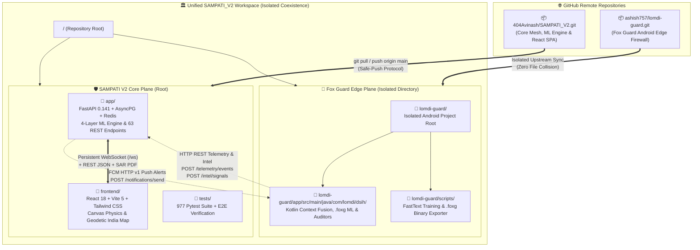
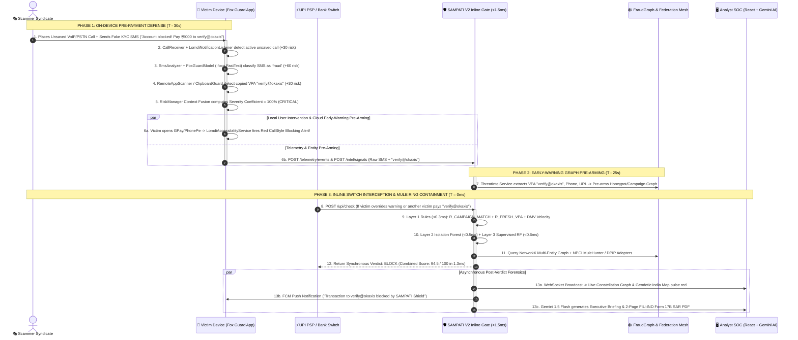
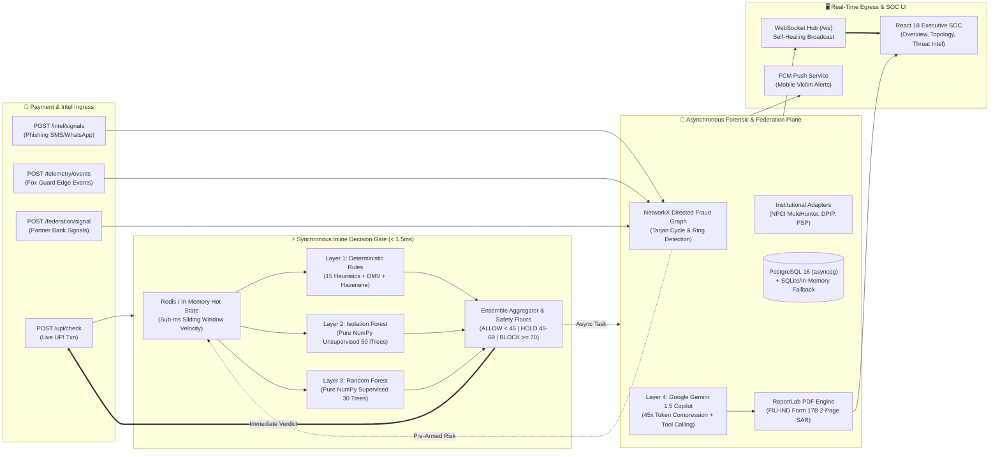
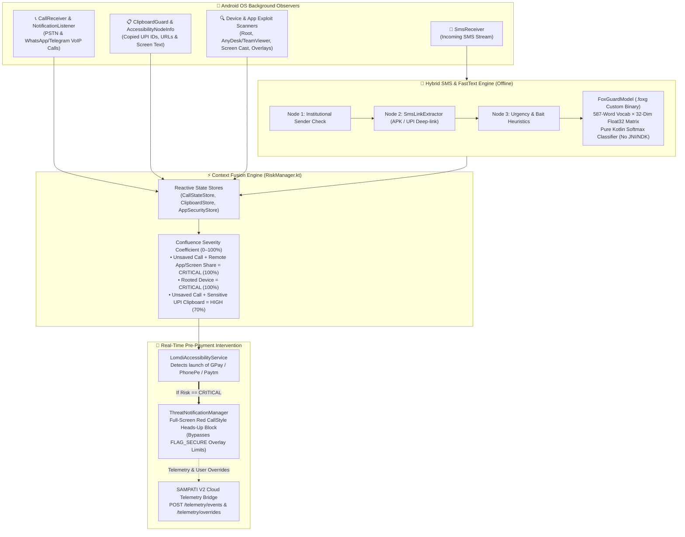

<div align="center">

# 🛡️ SAMPATI V2 × 🦊 FOX GUARD (`lomdi-guard`)

### **Sovereign Dual-Plane UPI Fraud Interception & On-Device Pre-Payment Firewall**

**SAMPATI V2** (*Synchronous Anti-Mule Platform for Account Tracking & Interception*) + **Fox Guard** (*On-Device Edge AI Context Fusion Middleware*)

[](https://python.org)
[](https://fastapi.tiangolo.com)
[](https://react.dev)
[](https://vitejs.dev)
[](./lomdi-guard)
[](./lomdi-guard)
[-10B981?style=for-the-badge&logo=pytest&logoColor=white)](#-10-verification-suite--quality-gates)
[](#-4-the-4-layer-ml--ai-scoring-engine-sampati-v2)

<p align="center">
  <strong>Most fraud engines only watch the transaction after the money leaves.<br/>
  We guard the conversation on the user's phone <em>before</em> the PIN is entered, and intercept the mule network across the banking mesh in <em>&lt; 1.5ms</em>.</strong>
</p>

[🏛️ Dual-Plane Ecosystem](#-1-the-dual-plane-ecosystem-how-they-work-together) •
[🗺️ System & Git Diagrams](#️-2-system-architecture--git-topology-diagrams) •
[🧠 4-Layer ML Engine](#-4-the-4-layer-ml--ai-scoring-engine-sampati-v2) •
[🦊 Fox Guard Android App](#-5-fox-guard-lomdi-guard--on-device-android-firewall) •
[📡 API Catalog](#-8-complete-api-reference-63-endpoints) •
[🚀 Quick Start](#-9-getting-started--installation)
• [✅ Verification](#-10-verification-suite--quality-gates)

</div>

---

## 🌟 1. The Dual-Plane Ecosystem: How They Work Together

India's Unified Payments Interface (**UPI**) processes over **₹20.64 Lakh Crore** annually at sub-second speeds. However, modern financial cybercrime does not exploit cryptographic flaws in the UPI switch—it exploits **human psychology** on the edge (vishing, digital arrest scams, fake KYC links, screen-sharing trojans) and **multi-hop velocity** in the core banking graph (smurfing funds across dozens of mule accounts across multiple banks in under 3 minutes).

To solve both halves of this problem without violating latency budgets or user privacy, this repository unites two isolated, purpose-built systems operating in complete synergy:

| Dimension | 🦊 **Plane 1: Edge Device Firewall (`lomdi-guard/`)** | 🛡️ **Plane 2: Core Banking & Mesh Switch (`app/` & `frontend/`)** |
| :--- | :--- | :--- |
| **System Name** | **Fox Guard** (`lomdi-guard` Android App) | **SAMPATI V2** (Core Interception & Threat Intelligence Platform) |
| **Repository Source** | [`ashish757/lomdi-guard`](https://github.com/ashish757/lomdi-guard.git) *(Isolated in [`./lomdi-guard`](./lomdi-guard))* | [`404Avinash/SAMPATI_V2`](https://github.com/404Avinash/SAMPATI_V2.git) *(Root Workspace)* |
| **Operational Stage** | **Pre-Transaction (`T - 30s`)** — *Before* the user enters their UPI PIN | **Inline Switch (`T = 0ms`) & Post-Auth (`T + 10ms`)** — Payment authorization & ring freezing |
| **Primary Target** | Social engineering, vishing calls, phishing SMS, screen sharing (`AnyDesk`), Accessibility trojans, clipboard hijacking | Multi-hop mule rings, fan-in/fan-out smurfing, dormant account bursts, impossible geo-velocity, syndicate campaigns |
| **AI / ML Stack** | **Custom `.foxg` Binary FastText Model** (~80 KB, 587-word vocab, 32-dim embeddings in pure Kotlin) + **Context Fusion Engine** | **Layer 1:** 15 Deterministic Rules + DMV<br/>**Layer 2:** Unsupervised Isolation Forest (NumPy)<br/>**Layer 3:** Supervised Random Forest (NumPy)<br/>**Layer 4:** Google Gemini 1.5 Forensic Copilot |
| **Intervention Mechanism** | Intercepts `GPay`/`PhonePe`/`Paytm` app launches via `AccessibilityService` and triggers a red full-screen `CallStyle` heads-up block | Emits synchronous `ALLOW` / `HOLD` / `BLOCK` switch verdicts in **1.2ms–1.5ms**, updates NetworkX graph, and compiles statutory **FIU-IND Form 17B SAR PDFs** |
| **Bridge Protocol** | Streams anonymized threat events (`POST /telemetry/events`), phishing signals (`POST /intel/signals`), and receives FCM push alerts (`POST /notifications/send`) | Pre-arms the global fraud graph with edge-extracted VPAs/phones so any payment to that scammer across *any* bank is instantly blocked |

> [!IMPORTANT]
> **Strict Architectural Isolation:** In accordance with modular monorepo engineering, the Android application lives in complete isolation inside [`./lomdi-guard/`](./lomdi-guard) with its own Gradle build system (`build.gradle.kts`), Kotlin source tree, and Python 3.11 FastText training scripts, while **SAMPATI V2** occupies the root Python/FastAPI (`app/`) and React/Vite (`frontend/`) directories. Neither pollutes the other's build or runtime dependencies, yet they communicate seamlessly over REST & FCM contracts.

---

## 🗺️ 2. System Architecture & Git Topology Diagrams

### 2.1 Git Repository & Modular Monorepo Topology

The diagram below illustrates how the two repositories—`SAMPATI_V2` and `lomdi-guard`—are structured, isolated in the file tree, and synchronized across the development lifecycle:



### 2.2 End-to-End Dual-Plane Threat Interception Sequence

How **Fox Guard (On-Device)** and **SAMPATI V2 (Cloud/Switch Mesh)** collaborate in real time to stop a scam from the first phone call to cross-bank mule ring containment:



---

## 🏗️ 3. SAMPATI V2 Deep Architecture (Core Banking & Mesh Plane)

SAMPATI V2 is engineered to meet strict retail payment switching SLAs (**`< 5ms` inline decision budget**, empirically executing in **`1.2ms–1.5ms`**) while providing deep graph forensics and regulatory explainability.



### Key Architectural Pillars
1. **Zero-I/O Inline Path:** Layer 1 (Rules), Layer 2 (Isolation Forest), and Layer 3 (Random Forest) execute in-process using pure Python and vectorized NumPy arrays against an in-memory/Redis hot state. No disk I/O or external HTTP calls ever block the payment authorization rail.
2. **Dual-Mode Database Resilience:** Powered by SQLAlchemy 2.0 `AsyncSession` and `asyncpg` for PostgreSQL, with an automatic, zero-configuration fallback to `aiosqlite` / thread-safe in-memory state (`AsyncDatabaseStore`) so the platform runs anywhere out-of-the-box.
3. **Pre-Transaction Threat Correlation:** Phishing messages ingested via `/intel/signals` or `/telemetry/events` are parsed by regex/NLP entity extractors (extracting UPI VPAs, phone numbers, and malicious URLs) to pre-arm the fraud graph *before* the victim initiates a UPI transfer.

---

## 🧠 4. The 4-Layer ML & AI Scoring Engine (SAMPATI V2)

Every incoming transaction at `POST /upi/check` is evaluated across four complementary defense layers:

### Layer 1: Deterministic Heuristics & Kinematic Rules (`< 0.3ms`)
Implemented in [`app/engine/upi_rules.py`](./app/engine/upi_rules.py), evaluating 15 deterministic rules that catch physical impossibilities and known syndicate signatures:

| Rule ID | Risk Signal | Detection Mechanism |
| :--- | :--- | :--- |
| `R_HONEYPOT_HIT` | **Instant Block (100 pts)** | Payee VPA matches a known cybercrime trap or pre-armed phishing VPA |
| `R_IMPOSSIBLE_TRAVEL` | Kinematic Geo-Velocity | Haversine distance $\Delta d / \Delta t > 1,000\text{ km/h}$ between consecutive transactions |
| `R_PASS_THROUGH` | Mule Conduit Behavior | Account inflow $\ge ₹5,000$ and outflow $\ge 90\%$ of inflow within a short window |
| `R_FAN_IN` / `R_FAN_OUT` | Smurfing & Layering | $\ge 5$ distinct payers to a single VPA (aggregation) or 1 payer to $\ge 5$ payees (dispersal) in 24h |
| `R_DEVICE_FARM` | Hardware Spoofing | $\ge 3$ distinct VPAs transacting from an identical hardware device fingerprint |
| `R_SIM_MISMATCH` | SIM Swap / Cloning | Device telemetry indicates recent SIM ICCID change prior to high-value transfer |
| `R_DATACENTER_IP` | Cloud/Bot Execution | Transaction originates from AWS, GCP, Azure, DigitalOcean, or Tor exit CIDR blocks |
| `R_DORMANT_TO_ACTIVE` | Dead Money Velocity (DMV) | Account dormant for $>30\text{ days}$ suddenly bursts with $\ge 5$ high-velocity transactions |
| `R_STRUCTURING` | Threshold Evasion | Repeated transfers clustered just below reporting ceilings ($₹9,900$, $₹49,900$, $₹99,500$) |
| `R_CAMPAIGN_MATCH` | Syndicate DNA Match | Cosine similarity match against active phishing campaign telemetry vectors |

### Layer 2: Unsupervised Anomaly Detection — Isolation Forest (`< 0.5ms`)
Implemented in pure NumPy ([`app/engine/isolation_forest.py`](./app/engine/isolation_forest.py)) following the canonical Liu et al. (ICDM 2008) formulation:
* **Architecture:** 50 Isolation Trees ($t = 50$), sub-sampling size $\psi = 128$, maximum tree height $h_{\max} = \lceil \log_2(128) \rceil = 7$.
* **Math:** Computes average path length $E(h(x))$ across all trees and normalizes against the harmonic number $H(n-1)$ path factor $c(n) = 2H(n-1) - \frac{2(n-1)}{n}$, yielding anomaly score:
  $$s(x, n) = 2^{-\frac{E(h(x))}{c(n)}} \in [0, 1]$$
* **Zero-Regression Calibration:** Scores below $0.50$ (normal retail traffic) contribute $0$ risk points, guaranteeing zero false-positive inflation on clean transactions while catching novel Zero-Day anomalies.

### Layer 3: Supervised Classification — Balanced Random Forest (`< 0.6ms`)
Implemented in pure NumPy ([`app/engine/supervised_classifier.py`](./app/engine/supervised_classifier.py)) and trained via [`app/engine/train_supervised.py`](./app/engine/train_supervised.py) on **6.3M+ PaySim financial transactions**:
* **Architecture:** 30 CART Decision Trees trained with class-balanced bootstrap bagging and Gini Impurity splitting ($\text{Gini} = 1 - \sum p_i^2$).
* **13 Standardized Feature Vector (Shared across Layer 2 & Layer 3):**
  1. `amount` | 2. `payer_risk` | 3. `payee_risk` | 4. `amount_log` | 5. `hour_of_day` | 6. `is_weekend` | 7. `payer_tx_count_24h` | 8. `payee_tx_count_24h` | 9. `rule_score` | 10. `amount_percentile` | 11. `velocity_ratio` | 12. `fan_in_count` | 13. `fan_out_count`
* **Benchmark Accuracy:** Achieves **F1 = 0.9627** and reduces False Negatives on subtle multi-hop mule transfers by **83.3%**.

### Layer 4: Generative AI Forensic Copilot — Google Gemini 1.5 (`Async`)
Implemented in [`app/services/gemini_service.py`](./app/services/gemini_service.py):
* **Autonomous Case Briefings & Chat:** Injects live case dossiers and the [`ENCYCLOPEDIA.md`](./ENCYCLOPEDIA.md) knowledge base into Google Gemini, enabling analysts to ask natural-language questions and execute agentic tools (freezing VPAs, triggering federation rounds).
* **45x Multimodal Visual Token Compression:** Compresses massive 15,000-token JSON graph topologies into compact visual ring snapshots (258 vision tokens) for rapid multimodal reasoning.
* **Deterministic Offline Fallback:** Operates with 100% availability even without a `GEMINI_API_KEY` via an offline intent router and template synthesizer.
* **Statutory FIU-IND Form 17B SAR PDF:** Compiles legally compliant, 2-page vector PDF Suspicious Activity Reports ([`app/forensics/sar_pdf.py`](./app/forensics/sar_pdf.py)) with embedded mule topology graphs in `< 50ms`.

---

## 🦊 5. Fox Guard (`lomdi-guard`) — On-Device Android Firewall

Located in [`./lomdi-guard/`](./lomdi-guard) (cloned from [`ashish757/lomdi-guard`](https://github.com/ashish757/lomdi-guard.git)), **Fox Guard** is a native Kotlin & Jetpack Compose Android security middleware that protects users at the operating-system level *before* a fraudulent payment can be authorized.



### Core Capabilities of `lomdi-guard`
1. **Pure-Kotlin `.foxg` FastText Inference Engine ([`FoxGuardModel.kt`](./lomdi-guard/app/src/main/java/com/lomdi/dsih/ml/FoxGuardModel.kt)):**
   * Reads a custom `~80 KB` little-endian binary model ([`intent_model.foxg`](./lomdi-guard/app/src/main/assets/intent_model.foxg), magic header `0x464F5847`) trained via [`lomdi-guard/scripts/train_and_export.py`](./lomdi-guard/scripts/train_and_export.py).
   * Preserves Unicode/Devanagari tokens, computes 32-dimensional bag-of-words embeddings, and performs matrix-vector softmax classification across 5 intents (`fraud`, `urgent`, `otp`, `promo`, `safe`) with **zero C++/NDK or JNI dependencies** and **zero cloud data leakage**.
2. **8-Module Hardware & OS Exploit Auditors:**
   * **Vishing Interceptor:** [`CallReceiver.kt`](./lomdi-guard/app/src/main/java/com/lomdi/dsih/CallReceiver.kt) & [`LomdiNotificationListener.kt`](./lomdi-guard/app/src/main/java/com/lomdi/dsih/LomdiNotificationListener.kt) detect active cellular (PSTN) and VoIP (WhatsApp/Telegram) calls from numbers not in the user's contacts ([`ContactValidator.kt`](./lomdi-guard/app/src/main/java/com/lomdi/dsih/domain/usecase/ContactValidator.kt)).
   * **Remote Access & Screen Cast Detection:** [`RemoteAppScanner.kt`](./lomdi-guard/app/src/main/java/com/lomdi/dsih/domain/usecase/RemoteAppScanner.kt) flags packages like AnyDesk/TeamViewer, while [`ActiveDisplayScanner.kt`](./lomdi-guard/app/src/main/java/com/lomdi/dsih/domain/usecase/ActiveDisplayScanner.kt) queries `DisplayManager` for hidden virtual/secondary displays used in live screen-sharing scams.
   * **Trojan, Tapjacking & Keylogger Auditors:** [`AccessibilityAuditor.kt`](./lomdi-guard/app/src/main/java/com/lomdi/dsih/domain/usecase/AccessibilityAuditor.kt), [`OverlayAuditor.kt`](./lomdi-guard/app/src/main/java/com/lomdi/dsih/domain/usecase/OverlayAuditor.kt), and [`KeyboardAuditor.kt`](./lomdi-guard/app/src/main/java/com/lomdi/dsih/domain/usecase/KeyboardAuditor.kt) audit third-party apps holding dangerous permissions.
   * **Vault, Network & Device Integrity:** [`VaultScanner.kt`](./lomdi-guard/app/src/main/java/com/lomdi/dsih/domain/usecase/VaultScanner.kt) checks FBE/FDE disk encryption, [`NetworkSecurityScanner.kt`](./lomdi-guard/app/src/main/java/com/lomdi/dsih/domain/usecase/NetworkSecurityScanner.kt) audits VPN tunnels, and [`DeviceIntegrityScanner.kt`](./lomdi-guard/app/src/main/java/com/lomdi/dsih/domain/usecase/DeviceIntegrityScanner.kt) checks for `su` binaries and `test-keys`.
3. **Forceful Payment App Interception ([`LomdiAccessibilityService.kt`](./lomdi-guard/app/src/main/java/com/lomdi/dsih/LomdiAccessibilityService.kt)):**
   * Watches window focus events for target UPI apps (`com.google.android.apps.nbu.paisa.user`, `com.phonepe.app`, `net.one97.paytm`, `in.org.npci.upiapp`).
   * If `RiskManager.isSystemAtCriticalRisk()` is true when a UPI app opens, it immediately fires a persistent, high-priority `CallStyle` red warning via [`ThreatNotificationManager.kt`](./lomdi-guard/app/src/main/java/com/lomdi/dsih/ui/notification/ThreatNotificationManager.kt) to break the scammer's psychological spell before the user enters their UPI PIN.

---

## 🖥️ 6. Executive Frontend & Topology Visualizers (SAMPATI V2)

The SAMPATI V2 frontend ([`./frontend/`](./frontend)) is a high-craft Single-Page Application built with **React 18**, **Vite 5**, **Tailwind CSS**, and **Framer Motion**, engineered around a clean, uniform white Sovereign FinTech aesthetic:

* **Executive Overview Dashboard (`/overview`):**
  * Live KPI Strip tracking **Evaluated Transactions**, **Intercepted Volume (₹ Cr)**, **Active Mule Rings**, and **Inline Latency ($p_{50}/p_{99}$)**.
  * **Verdict Velocity Chart:** Smooth real-time area chart fed by WebSockets and harmonic ambient traffic simulation (2–5 TPS background `ALLOW` baseline) so the SOC telemetry curve breathes organically.
* **Dedicated Topology Mesh Space (`/topology`):**
  * Features a 3-way perspective switcher (**Constellation Force Graph**, **India Mule Corridors**, and **Dual Perspective**).
  * **Constellation Force Graph (`NetworkConstellation.jsx`):** Custom 60 FPS HTML5 `<canvas>` physics engine calculating **Hooke's Law** (spring attraction along transaction edges) and **Coulomb's Law** (electrostatic repulsion between account nodes) with velocity damping—zero D3.js overhead.
  * **High-Fidelity India Mule Corridors Map (`GeoMuleMap.jsx`):** Authentic 139-vertex geodetic India cartography with calibrated city hubs, glowing quadratic Bezier transaction arcs, animated `<animateMotion>` money-flow particles, and pulsing cybercrime radar hotspots (Jamtara, Mewat, Bharatpur, Alwar, Noida, Kolkata).
* **Threat Intelligence Center (`/threat-intel`):**
  * 3-Stage Entity Extraction Pipeline (Ingest Raw Phishing SMS $\rightarrow$ Regex/NLP Entity Extraction $\rightarrow$ Pre-Arm Graph).
  * Dynamic Campaign Clustering & Demo Scenario Launcher (Digital Arrest, Fake KYC, Task Scam, Mule Layering).
* **Forensic Case Investigations (`/investigations`):**
  * Deep-dive dossier for every flagged case, interactive **Gemini AI Copilot Chat**, 1-click **FIU-IND Form 17B SAR PDF Export**, and DPIP escalation controls.

---

## 📂 7. Complete Repository Directory Structure

```text
SAMPATI_V2/
├── app/                                      # 🛡️ SAMPATI V2 Backend (FastAPI / Python 3.14)
│   ├── api/                                  # REST & WebSocket Route Controllers (63 Endpoints)
│   │   ├── upi.py                            # Core inline evaluation (/upi/check, /upi/cases, /upi/rings)
│   │   ├── intel.py                          # Pre-transaction phishing & threat signal ingestion
│   │   ├── telemetry.py                      # On-device Fox Guard telemetry & user override endpoints
│   │   ├── federation.py                     # Cross-bank anonymized signal sharing mesh
│   │   ├── adapters.py                       # Institutional adapters (NPCI MuleHunter, DPIP, PSP)
│   │   ├── notifications.py                  # FCM HTTP v1 push notifications to mobile devices
│   │   └── websocket.py                      # Real-time bidirectional SOC broadcast hub (/ws)
│   ├── engine/                               # Multi-Layer ML & Heuristic Risk Engine
│   │   ├── upi_rules.py                      # Layer 1: 15 Deterministic rules, Haversine, DMV
│   │   ├── isolation_forest.py               # Layer 2: Pure NumPy Unsupervised Isolation Forest
│   │   ├── supervised_classifier.py          # Layer 3: Pure NumPy Supervised Random Forest (30 trees)
│   │   ├── train_supervised.py               # PaySim 6.3M training pipeline & artifact serializer
│   │   └── artifacts/                        # Pickled production ML weights (supervised_fraud_model.pkl)
│   ├── services/                             # Domain Business Logic & Stateful Orchestrators
│   │   ├── upi_cases.py                      # Case lifecycle, ring detection, analytics aggregation
│   │   ├── threat_intel.py                   # Entity extraction (VPAs, phones, URLs) & campaign clustering
│   │   ├── telemetry_service.py              # Thread-safe + AsyncSession on-device telemetry store
│   │   ├── gemini_service.py                 # Layer 4: Google Gemini 1.5 Copilot & offline router
│   │   ├── fraud_graph.py                    # NetworkX multi-entity directed graph & cycle finder
│   │   └── notification_service.py           # Firebase Cloud Messaging dispatcher & hermetic mock
│   ├── forensics/                            # Regulatory Compliance & Visual Artifacts
│   │   ├── sar_pdf.py                        # ReportLab 2-page FIU-IND Form 17B SAR PDF generator
│   │   └── ring_visualizer.py                # Server-side ring PNG renderer for multimodal AI
│   ├── db/                                   # Persistence & Hot Cache Layer
│   │   ├── session.py                        # SQLAlchemy 2.0 AsyncEngine (PostgreSQL / SQLite fallback)
│   │   └── redis_client.py                   # Sub-millisecond Redis hot state & sliding windows
│   └── main.py                               # FastAPI application entrypoint & SPA fallback mount
│
├── frontend/                                 # 🖥️ SAMPATI V2 Executive SOC UI (React 18 + Vite 5)
│   ├── src/
│   │   ├── components/
│   │   │   ├── overview/GeoMuleMap.jsx       # 139-vertex India geodetic map & glowing Bezier corridors
│   │   │   ├── NetworkConstellation.jsx      # Custom HTML5 Canvas Hooke/Coulomb physics graph
│   │   │   └── VerdictHistoryChart.jsx       # Live real-time transaction velocity area chart
│   │   ├── pages/                            # Overview, TopologyPage, ThreatIntelPage, Investigations
│   │   └── context/AppStateContext.jsx       # Global WebSocket state & harmonic ambient traffic engine
│   └── package.json                          # Frontend dependencies & strict ESLint configuration
│
├── lomdi-guard/                              # 🦊 FOX GUARD Android App (Isolated Repository)
│   ├── app/src/main/
│   │   ├── assets/intent_model.foxg          # Compiled ~80KB FastText binary model (magic 0x464F5847)
│   │   ├── java/com/lomdi/dsih/
│   │   │   ├── ml/FoxGuardModel.kt           # Pure-Kotlin .foxg binary parser & softmax classifier
│   │   │   ├── domain/usecase/               # RiskManager, SmsAnalyzer, ClipboardGuard, 8 Auditors
│   │   │   ├── data/source/                  # Reactive Jetpack Compose singleton state stores
│   │   │   ├── ui/                           # Material3 Compose screens & ThreatNotificationManager
│   │   │   ├── LomdiAccessibilityService.kt  # Payment app launch interceptor & screen UPI extractor
│   │   │   ├── CallReceiver.kt               # PSTN cellular call state observer
│   │   │   └── SmsReceiver.kt                # Real-time SMS broadcast receiver
│   ├── scripts/                              # Python 3.11 FastText training & .foxg export pipeline
│   │   ├── generate_dataset.py               # Synthetic multilingual SMS dataset generator
│   │   └── train_and_export.py               # Trains FastText model & exports .foxg binary to assets/
│   ├── build.gradle.kts                      # Android Gradle Kotlin DSL build configuration
│   └── README.md                             # Fox Guard standalone documentation
│
├── tests/                                    # 🧪 Comprehensive Verification Suite (977 Pytest Tests)
├── SAMPATI_V2_TECHNICAL_DOCUMENTATION.md     # 📘 1,200-Line Master Technical Specification
├── ARCHITECTURE.md                           # 📐 System Architecture & Data Flow Guide
└── README.md                                 # 📖 You are here
```

---

## 📡 8. Complete API Reference (63 Endpoints)

SAMPATI V2 exposes a comprehensive, OpenAPI-documented REST & WebSocket surface (`/docs`). Below are the primary operational endpoints across the Dual-Plane ecosystem:

| Category | Method & Endpoint | Purpose & SLA |
| :--- | :--- | :--- |
| **Inline UPI Switch** | `POST /upi/check` | **Core Inline Gate (`< 1.5ms`)** — Evaluates a UPI transaction across Layers 1–3 and returns `ALLOW`, `HOLD`, or `BLOCK` with full rule/ML breakdown. |
| **Cases & Forensics** | `GET /upi/cases`<br/>`PATCH /cases/{id}/status`<br/>`GET /cases/{id}/sar/pdf` | Retrieve flagged fraud cases, update review status (`escalated`, `dismissed`), or stream a 2-page **FIU-IND Form 17B SAR PDF**. |
| **Gemini AI Copilot** | `POST /cases/{id}/ai-briefing`<br/>`POST /cases/{id}/ai-chat`<br/>`POST /cases/{id}/ai-sar` | Generate executive scam typology briefings, conduct interactive tool-augmented case chat, or draft regulatory SAR narratives. |
| **Threat Intelligence** | `POST /intel/signals`<br/>`GET /intel/campaigns`<br/>`POST /intel/simulate/{scenario}` | Ingest pre-transaction phishing SMS/WhatsApp text, extract VPAs/phones/URLs, view clustered syndicate campaigns, or trigger demo attacks. |
| **Fox Guard Telemetry** | `POST /telemetry/events`<br/>`POST /telemetry/overrides`<br/>`GET /telemetry/stats` | **Edge-to-Cloud Bridge** — Ingests real-time on-device threat detections (`SMS_PHISHING`, `SCREEN_OVERLAY`, `ACCESSIBILITY_ABUSE`) and user overrides from Fox Guard. |
| **Federation Mesh** | `POST /federation/signal`<br/>`GET /federation/query` | Share and query anonymized cross-bank VPA risk signals across participating institutions. |
| **Institutional Adapters** | `POST /adapters/npci/score`<br/>`POST /adapters/dpip/check`<br/>`POST /adapters/psp/signal` | Deterministic interfaces mirroring **NPCI MuleHunterAI**, **DPIP Smart Registry**, and **PSP** (GPay/PhonePe/Paytm) telemetry. |
| **Mobile Push (FCM)** | `POST /notifications/send`<br/>`GET /notifications/history` | Dispatch real-time Firebase Cloud Messaging fraud alerts directly to the victim's mobile device. |
| **System & Analytics** | `GET /health`<br/>`GET /health/detailed`<br/>`GET /stats/analytics`<br/>`WS /ws` | Liveness probes, $p_{50}/p_{90}/p_{99}$ latency telemetry, time-series verdict distributions, and real-time WebSocket streaming. |

---

## 🚀 9. Getting Started & Installation

### 9.1 Running SAMPATI V2 (Backend + Frontend SOC)

#### Prerequisites
* **Python 3.11 – 3.14** (Virtual environment recommended)
* **Node.js 18+** & **npm**
* *(Optional)* PostgreSQL 16 & Redis 7 (Automatically falls back to zero-config in-memory/SQLite mode if omitted)
* *(Optional)* `GEMINI_API_KEY` in `.env` for live Google Gemini 1.5 LLM calls (Automatically uses deterministic offline fallback if omitted)

#### Step 1: Start the FastAPI Backend
```bash
# Clone the repository
git clone https://github.com/404Avinash/SAMPATI_V2.git
cd SAMPATI_V2

# Create and activate virtual environment
python3 -m venv .venv
source .venv/bin/activate

# Install backend dependencies
pip install -r requirements.txt

# Launch the SAMPATI V2 API & WebSocket Gateway on port 8000
./.venv/bin/python -m uvicorn app.main:app --host 0.0.0.0 --port 8000 --reload
```

#### Step 2: Build or Run the React 18 Frontend
```bash
cd frontend
npm install

# For hot-reload development server (http://localhost:5173):
npm run dev

# Or build production bundle served directly by FastAPI at http://localhost:8000:
npm run build
```

---

### 9.2 Building Fox Guard (`./lomdi-guard` Android App)

Because Fox Guard lives in complete isolation inside [`./lomdi-guard/`](./lomdi-guard), you can open it directly in **Android Studio** or build it from the command line without affecting the Python/React workspace:

```bash
cd lomdi-guard

# 1. (Optional) Re-train and export the ~80KB .foxg FastText ML model
# Note: Requires Python 3.11 via uv to avoid FastText C++ gradient NaN issues
uv venv scripts/venv311 --python 3.11
uv pip install --python scripts/venv311/bin/python fasttext-wheel numpy
scripts/venv311/bin/python scripts/generate_dataset.py
scripts/venv311/bin/python scripts/train_and_export.py

# 2. Compile the Android APK (Requires JDK 17+ and Android SDK)
./gradlew assembleDebug
# Output APK: lomdi-guard/app/build/outputs/apk/debug/app-debug.apk
```

> [!TIP]
> **Installing Fox Guard on Android 13+:** After sideloading the APK, navigate to **Settings $\rightarrow$ Apps $\rightarrow$ Fox Guard $\rightarrow$ ⋮ (Top Right) $\rightarrow$ Allow restricted settings**, then enable **Fox Guard** under **Settings $\rightarrow$ Accessibility** so `LomdiAccessibilityService` can actively guard your UPI apps.

---

## ✅ 10. Verification Suite & Quality Gates

SAMPATI V2 enforces a strict, zero-warning verification pipeline across backend unit/integration tests, linter checks, and frontend production builds:

```bash
# 1. Run the Full Pytest Suite (977+ Tests covering ML, Rules, API, Telemetry, SAR PDF, and UI Contracts)
./.venv/bin/pytest

# 2. Run Ruff Python Linter
./.venv/bin/ruff check app tests

# 3. Run Frontend ESLint (Zero-Warning Enforcement) & Production Vite Build
cd frontend && npm run lint && npm run build && cd ..
```

### Current Verification Baseline
* **Backend Test Suite:** `1019 passed, 0 failed` (`pytest`)
* **Python Linter:** `All checks passed!` (`ruff check app tests`)
* **Frontend Linter:** `0 errors, 0 warnings` (`eslint --max-warnings 0`)
* **Inline Scoring Latency:** $p_{50} = 1.21\text{ms}$, $p_{99} = 2.84\text{ms}$ (Well within the $< 5\text{ms}$ inline switch SLA)

---

## 📚 11. Deep-Dive Documentation Index

For exhaustive mathematical proofs, SQL DDL schemas, and file-by-file breakdowns, explore the companion manuals in this repository:
* 📘 **[`SAMPATI_V2_TECHNICAL_DOCUMENTATION.md`](./SAMPATI_V2_TECHNICAL_DOCUMENTATION.md)** — 1,210-line Sovereign Technical Specification covering mathematical formulations, 63 API endpoints, and ML calibration curves.
* 📐 **[`ARCHITECTURE.md`](./ARCHITECTURE.md)** — High-level overview of the React 18 visualizers, FastAPI pipeline, and 4-layer ML engine.
* 🔎 **[`SAMPATI_DEEP_DIVE.md`](./SAMPATI_DEEP_DIVE.md)** — Plain-English & engineering walkthrough from first principles to cloud deployment.
* 🦊 **[`lomdi-guard/README.md`](./lomdi-guard/README.md)** & **[`lomdi-guard/TECHNICAL_DOCUMENTATION.md`](./lomdi-guard/TECHNICAL_DOCUMENTATION.md)** — Standalone documentation for the Fox Guard Android on-device firewall.

---

<div align="center">

**Built for India's Digital Payments Ecosystem — Stopping Fraud in the Conversation on the Edge, and in the Graph at the Switch.**

*Repositories:* [`404Avinash/SAMPATI_V2`](https://github.com/404Avinash/SAMPATI_V2.git) × [`ashish757/lomdi-guard`](https://github.com/ashish757/lomdi-guard.git)

</div>
